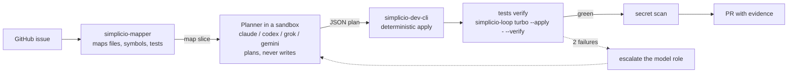
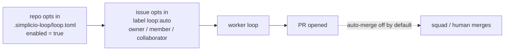
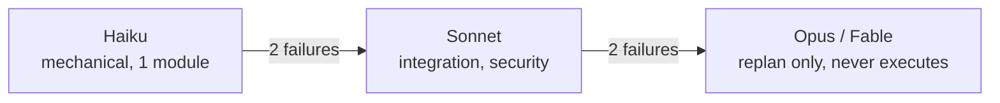
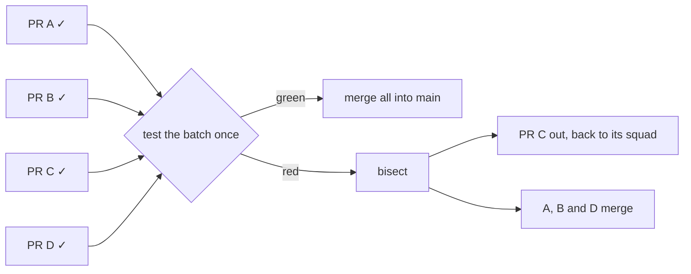
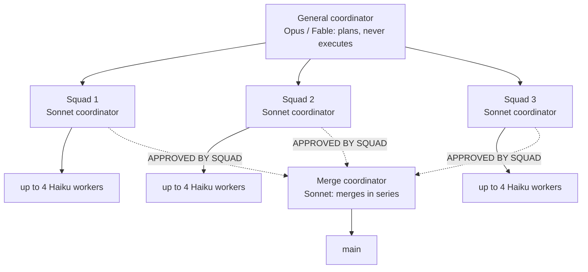
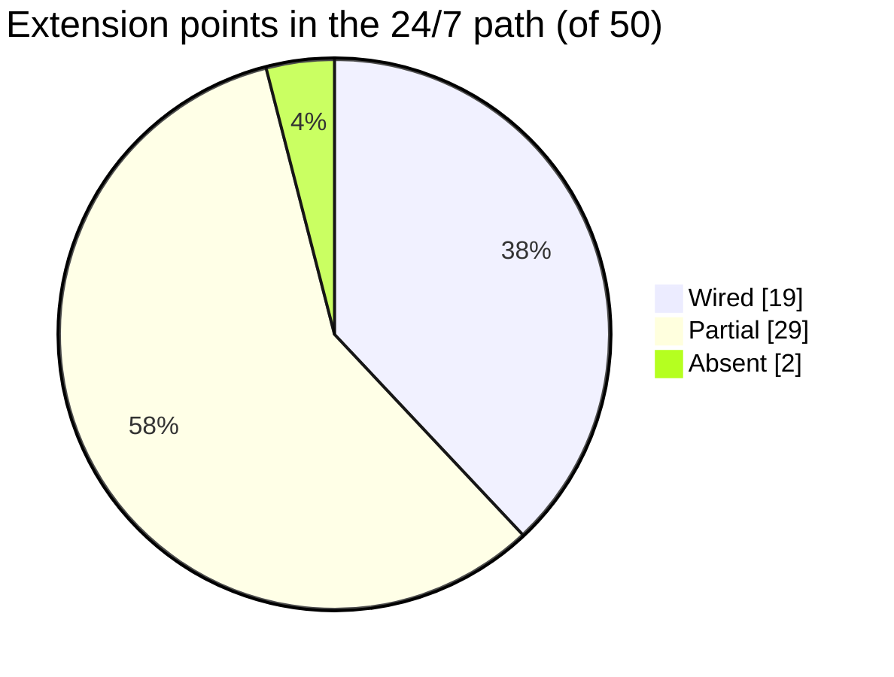

# 🔁 simplicio-loop

<p align="center">
  <a href="docs/REPOSITORY_GOVERNANCE.md"></a>
  <a href="https://github.com/simpletibr/simplicio-loop/stargazers"></a>
  <a href="docs/EXTENSION_POINTS_SERVICE.md"></a>
  <a href="LICENSE"></a>
  <a href="https://discord.gg/wM6tr7xVb"></a>
</p>

<p align="center">
  <a href="README.md">🇬🇧 English</a> |
  <a href="READMEs/README.pt-BR.md">🇧🇷 Português</a> |
  <a href="READMEs/README.es-ES.md">🇪🇸 Español</a> |
  <a href="READMEs/README.fr-FR.md">🇫🇷 Français</a> |
  <a href="READMEs/README.de-DE.md">🇩🇪 Deutsch</a> |
  <a href="READMEs/README.it-IT.md">🇮🇹 Italiano</a> |
  <a href="READMEs/README.ja-JP.md">🇯🇵 日本語</a> |
  <a href="READMEs/README.ko-KR.md">🇰🇷 한국어</a> |
  <a href="READMEs/README.zh-CN.md">🇨🇳 简体中文</a> |
  <a href="READMEs/README.ru-RU.md">🇷🇺 Русский</a> |
  <a href="READMEs/README.pl-PL.md">🇵🇱 Polski</a> |
  <a href="READMEs/README.tr-TR.md">🇹🇷 Türkçe</a> |
  <a href="READMEs/README.nl-NL.md">🇳🇱 Nederlands</a> |
  <a href="READMEs/README.hi-IN.md">🇮🇳 हिन्दी</a> |
  <a href="READMEs/README.ar-SA.md">🇸🇦 العربية</a>
</p>

**simplicio-loop ships three deterministic operators that any agent harness can call as plain tools: `simplicio-mapper` surveys a repo, `simplicio-dev-cli` applies an edit plan exactly, and impact-based test selection (`scripts/impact_tests.py`) runs only the tests a change can reach. The loop that turns GitHub issues into tested PRs is one consumer of them.**

## The operators

Looping an agent is no longer the hard part: agent SDKs and frameworks now ship it. The part that must not be probabilistic is reading the repo, writing the edit and choosing the tests. These three tools do that work, none of them provisions a model, and each prints machine-readable output. Your agent (Claude Code, Codex, Cursor, a LangGraph graph, a shell script) decides; they execute.

| Operator | What it does | Call it from any harness |
| --- | --- | --- |
| `simplicio-mapper` (survey) | Walks the repo locally, without an LLM, and returns a bounded context pack for a goal instead of the whole tree. [Docs](packages/mapper/README.md) | `simplicio-mapper handoff . --goal "trace the authentication flow" --token-budget 1200 --json` |
| `simplicio-dev-cli` (deterministic apply) | Applies a find/replace edit plan where each `find` must match exactly once, runs a scoped verification and prints one JSON receipt. It never provisions an LLM, per its README. [Docs](packages/dev-cli/README.md) | `simplicio-dev-cli edit --root . --plan plan.json --apply --check "<tests>" --json` |
| Impact-based test selection | `scripts/impact_tests.py` diffs the working tree against a base ref at symbol level and selects the test files that reach a changed function, class or assignment. `scripts/check.py` uses it, so a change runs only the tests it can affect. [Docs](docs/GUIDE.md#-tests--local-checks-no-paid-ci) | `python3 scripts/impact_tests.py --base origin/main --json` |

`pip install simplicio-loop` puts `simplicio-mapper` and `simplicio-dev-cli` on your PATH (one wheel, Python 3.11+). `scripts/impact_tests.py` is a standard-library script with no install step: run it from a checkout or copy it into your repo.

This README quotes no savings figure. Measurements live in [bench/llm_ab](bench/llm_ab/README.md), where the raw per-run results are in `bench/llm_ab/results/` (small A/B, a single model), and anything not measured there is not claimed.

## The loop is one consumer of them

The loop is the reference consumer: it takes a GitHub issue, has the mapper survey the repo, lets a planner in a sandbox write a JSON plan, hands that plan to `simplicio-dev-cli`, then runs the tests (in this repo, `scripts/check.py` runs the impact-selected subset) before it opens a PR. Swap the loop for any other harness and the operators work the same.

<p align="center">
  
</p>

<p align="center">
  
</p>



## Install

Needs Python 3.11+, `git`, and an authenticated `gh` for GitHub issues.

```bash
pip install simplicio-loop
simplicio-loop install            # skills + hooks in this project (--global: user-wide, --host <name>: another host)
simplicio-loop doctor             # check the installed stack
simplicio-loop prepare --example  # print a valid task file: copy it, edit it, pass it to --task
```

`prepare --example` starts like this:

```text
System: calc
Feature: add mul(a, b)
Type: Feature
```

Then give your agent the goal in [Use it](#use-it).

`simplicio-loop login` is not needed for this. It signs in through the Simplicio Runtime, and only the 24/7 watcher needs a login. Until you sign in, `doctor` shows the login as a warning; that is expected. Without the Runtime, `login` prints the public installer command for your OS and does not run it.

## Use it

**In Claude Code or VS Code:**

```text
/simplicio-loop finish all the open issues
```


**As a 24/7 watcher** (a service that watches `simpletibr/simplicio-*` repos and opens PRs):

```bash
simplicio-loop watch247 --once --dry-run          # one simulated tick, changes nothing
simplicio-loop watch247 login-check               # are the exec CLIs logged in?
# from a repo checkout, as root, after creating the non-root user simplicio-loop:
sudo cp packaging/systemd/simplicio-loop-247.service /etc/systemd/system/
sudo cp packaging/systemd/simplicio-loop-247.env.example /etc/simplicio-loop-247.env   # edit it, then chmod 600
sudo systemctl enable --now simplicio-loop-247
```



Details: [docs/WATCHER_247.md](docs/WATCHER_247.md).

**Live Dashboard (Simplicio Live):**

```bash
simplicio-loop dashboard                  # start or reuse dashboard on 127.0.0.1:8765
simplicio-loop dashboard --status         # check dashboard status
simplicio-loop dashboard --stop           # stop the dashboard
```

Remote access routes:
- **Local / SSH tunnel (recommended)**: `ssh -L 8765:127.0.0.1:8765 user@remote` then open `http://127.0.0.1:8765/?t=<token>`.
- **Tailscale**: Connect via Tailscale MagicDNS (`http://<node>.ts.net:8765/?t=<token>` or HTTPS `https://<node>.ts.net/?t=<token>`) with a valid access token.
- **Custom host**: Allow specific Host headers with `--allow-host <hostname>` (e.g. `simplicio-loop dashboard --allow-host mybox.internal`).

## How it works

<p align="center">
  
</p>



<p align="center">
  
</p>



<p align="center">
  
</p>



<p align="center">
  
</p>

## The 50 extension points



[docs/EXTENSION_POINTS_SERVICE.md](docs/EXTENSION_POINTS_SERVICE.md) · [#1509](https://github.com/simpletibr/simplicio-loop/issues/1509)

## Runtimes

- **26 wired adapters** ship code in `adapters/` and a host test: Claude Code, Codex, Cursor, Grok, Kiro, VS Code, and
  20 `AGENTS.md` hosts on the `.claude/skills/` surface (see [adapters/MATRIX.md](adapters/MATRIX.md)).
- **9 listed hosts** are catalog entries with a README and no adapter code; 8 of them also have a generic installer target that writes the skills and the host's entry file. A listing is not proof that the host runs the loop.
- The operators above are plain commands, so they work from any harness, wired or not. Per-host status: [adapters/MATRIX.md](adapters/MATRIX.md) and [simplicio_loop/_catalog/harnesses.json](simplicio_loop/_catalog/harnesses.json).

## Learn more

- [INSTALL.md](INSTALL.md) · [docs/CLI_COMMANDS.md](docs/CLI_COMMANDS.md) · [docs/WATCHER_247.md](docs/WATCHER_247.md)
- [docs/MODEL_ROLES.md](docs/MODEL_ROLES.md) · [docs/DASHBOARD.md](docs/DASHBOARD.md) · [CHANGELOG.md](CHANGELOG.md)
- **Everything else: [docs/GUIDE.md](docs/GUIDE.md)** (skills, runtimes, the loop, token economy, safety, tests)
