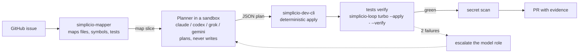
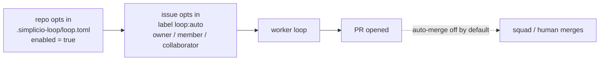
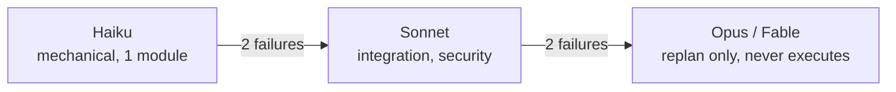
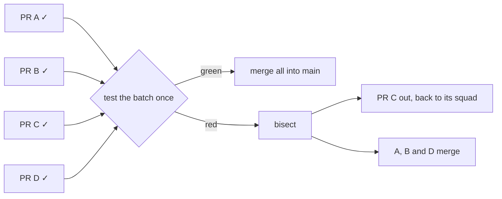
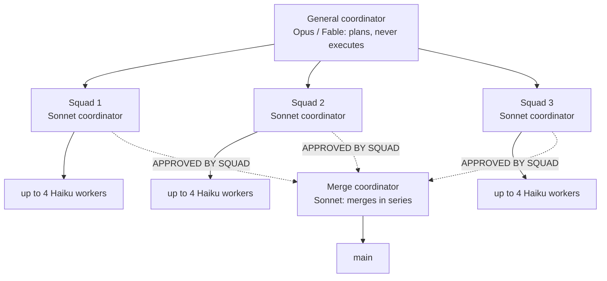
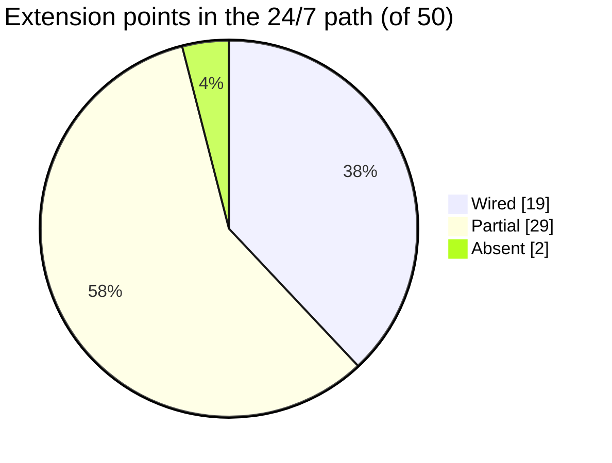

# 🔁 simplicio-loop

<p align="center">
  <a href="../docs/REPOSITORY_GOVERNANCE.md"></a>
  <a href="https://github.com/simpletibr/simplicio-loop/stargazers"></a>
  <a href="../docs/EXTENSION_POINTS_SERVICE.md"></a>
  <a href="../LICENSE"></a>
  <a href="https://discord.gg/wM6tr7xVb"></a>
</p>

<p align="center">
  <a href="../README.md">🇬🇧 English</a> |
  <a href="README.pt-BR.md">🇧🇷 Português</a> |
  <a href="README.es-ES.md">🇪🇸 Español</a> |
  <a href="README.fr-FR.md">🇫🇷 Français</a> |
  <a href="README.de-DE.md">🇩🇪 Deutsch</a> |
  <a href="README.it-IT.md">🇮🇹 Italiano</a> |
  <a href="README.ja-JP.md">🇯🇵 日本語</a> |
  <a href="README.ko-KR.md">🇰🇷 한국어</a> |
  <a href="README.zh-CN.md">🇨🇳 简体中文</a> |
  <a href="README.ru-RU.md">🇷🇺 Русский</a> |
  <a href="README.pl-PL.md">🇵🇱 Polski</a> |
  <a href="README.tr-TR.md">🇹🇷 Türkçe</a> |
  <a href="README.nl-NL.md">🇳🇱 Nederlands</a> |
  <a href="README.hi-IN.md">🇮🇳 हिन्दी</a> |
  <a href="README.ar-SA.md">🇸🇦 العربية</a>
</p>

**simplicio-loop incluye tres operadores deterministas que cualquier harness de agentes puede llamar como herramientas: `simplicio-mapper` relevea el repo, `simplicio-dev-cli` aplica un plan de edición exactamente, y la selección de tests por impacto (`scripts/impact_tests.py`) ejecuta solo los tests que el cambio alcanza. El loop que convierte issues de GitHub en PRs probados es un consumidor de ellos.**

<p align="center">
  
</p>

<p align="center">
  
</p>

## Los operadores

Hacer que un agente itere ya no es lo difícil: los SDK y frameworks de agentes ya lo incluyen. La parte que no debe ser probabilística es leer el repo, escribir la edición y elegir los tests. Estas tres herramientas hacen ese trabajo, ninguna provisiona un modelo y todas imprimen salida legible por máquina. Tu agente (Claude Code, Codex, Cursor, un grafo de LangGraph, un script de shell) decide; ellas ejecutan.

| Operador | Qué hace | Llámalo desde cualquier harness |
| --- | --- | --- |
| `simplicio-mapper` (survey) | Recorre el repo localmente, sin LLM, y devuelve un paquete de contexto acotado para un objetivo en vez de todo el árbol. [Docs](../packages/mapper/README.md) | `simplicio-mapper handoff . --goal "trace the authentication flow" --token-budget 1200 --json` |
| `simplicio-dev-cli` (aplicación determinista) | Aplica un plan de edición find/replace donde cada `find` debe coincidir exactamente una vez, ejecuta una verificación acotada e imprime un recibo JSON. No provisiona un LLM, según su propio README. [Docs](../packages/dev-cli/README.md) | `simplicio-dev-cli edit --root . --plan plan.json --apply --check "<tests>" --json` |
| Selección de tests por impacto | `scripts/impact_tests.py` compara el árbol de trabajo con una ref base a nivel de símbolo y selecciona los archivos de test que alcanzan una función, clase o asignación cambiada. `scripts/check.py` lo usa, así que un cambio ejecuta solo los tests que puede afectar. [Docs](../docs/GUIDE.md#-tests--local-checks-no-paid-ci) | `python3 scripts/impact_tests.py --base origin/main --json` |

`pip install simplicio-loop` pone `simplicio-mapper` y `simplicio-dev-cli` en tu PATH (una wheel, Python 3.11+). `scripts/impact_tests.py` es un script de la biblioteca estándar sin paso de instalación: ejecútalo desde un checkout o cópialo a tu repo.

Este README no cita ninguna cifra de ahorro. Las mediciones están en [bench/llm_ab](../bench/llm_ab/README.md), donde los resultados brutos por ejecución están en `bench/llm_ab/results/` (A/B pequeño, un solo modelo); lo que no se midió allí no se afirma.

## El loop es uno de sus consumidores

El loop es el consumidor de referencia: toma un issue de GitHub, pide al mapper el mapa del repo, deja que un planificador en sandbox escriba un plan JSON, entrega ese plan a `simplicio-dev-cli` y ejecuta los tests (en este repo, `scripts/check.py` ejecuta el subconjunto seleccionado por impacto) antes de abrir un PR. Cambia el loop por otro harness y los operadores funcionan igual.



## Instalación

Requiere Python 3.11+, `git` y un `gh` autenticado para las issues de GitHub.

```bash
pip install simplicio-loop
simplicio-loop install            # skills + hooks in this project (--global: user-wide, --host <name>: another host)
simplicio-loop doctor             # check the installed stack
```

## Uso

**En Claude Code o VS Code:**

```text
/simplicio-loop finish all the open issues
```

**Como watcher 24/7** (un servicio que vigila los repos `simpletibr/simplicio-*` y abre PRs):

```bash
simplicio-loop watch247 --once --dry-run          # one simulated tick, changes nothing
simplicio-loop watch247 login-check               # are the exec CLIs logged in?
# from a repo checkout, as root, after creating the non-root user simplicio-loop:
sudo cp packaging/systemd/simplicio-loop-247.service /etc/systemd/system/
sudo cp packaging/systemd/simplicio-loop-247.env.example /etc/simplicio-loop-247.env   # edit it, then chmod 600
sudo systemctl enable --now simplicio-loop-247
```

Detalles: [docs/WATCHER_247.md](../docs/WATCHER_247.md).



## Cómo funciona

<p align="center">
  
</p>



<p align="center">
  
</p>



<p align="center">
  
</p>



<p align="center">
  
</p>

## Los 50 puntos de extensión



[docs/EXTENSION_POINTS_SERVICE.md](../docs/EXTENSION_POINTS_SERVICE.md) · [#1509](https://github.com/simpletibr/simplicio-loop/issues/1509)

## Runtimes

- **6 `wired`** adaptadores tienen código en `adapters/` y un test de host: Claude Code, Codex, Cursor, Grok, Kiro y VS Code.
- **29 `listed`** hosts son entradas del catálogo con README y sin código de adaptador; 28 de ellos también tienen un destino de instalación genérico que escribe las skills y el archivo de entrada del host. Estar listado no prueba que el host ejecute el loop.
- Los operadores de arriba son comandos simples, así que funcionan desde cualquier harness, `wired` o no. Estado por host: [adapters/MATRIX.md](../adapters/MATRIX.md) y [simplicio_loop/_catalog/harnesses.json](../simplicio_loop/_catalog/harnesses.json).

## Más información

- [INSTALL.md](../INSTALL.md) · [docs/CLI_COMMANDS.md](../docs/CLI_COMMANDS.md) · [docs/WATCHER_247.md](../docs/WATCHER_247.md)
- [docs/MODEL_ROLES.md](../docs/MODEL_ROLES.md) · [docs/DASHBOARD.md](../docs/DASHBOARD.md) · [CHANGELOG.md](../CHANGELOG.md)
- **Todo lo demás: [docs/GUIDE.md](../docs/GUIDE.md)** (skills, runtimes, el loop, economía de tokens, seguridad, tests; en inglés)
