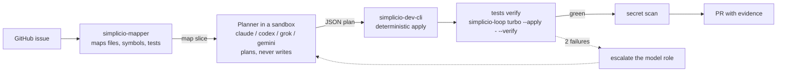
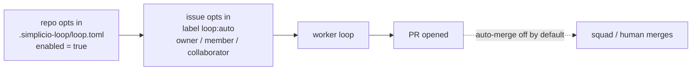
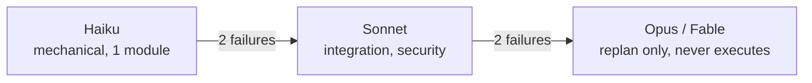
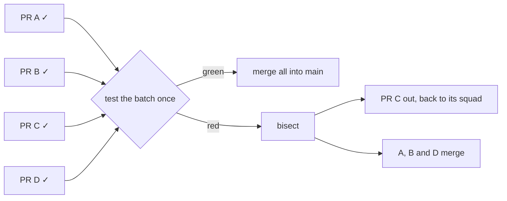
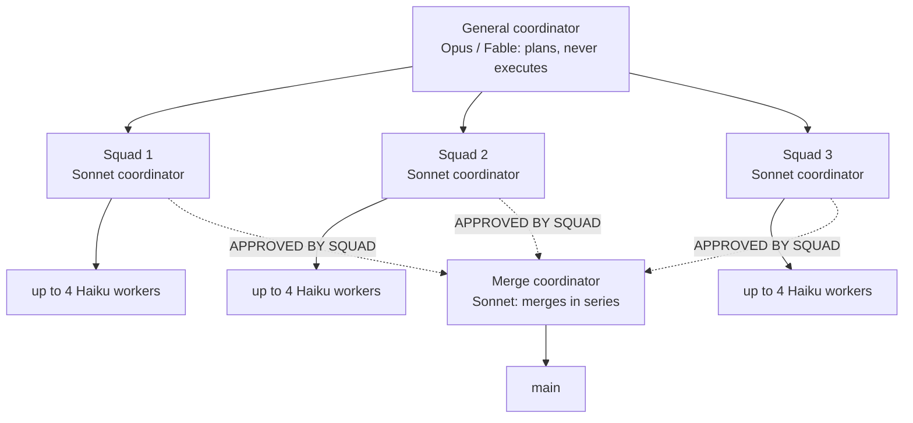
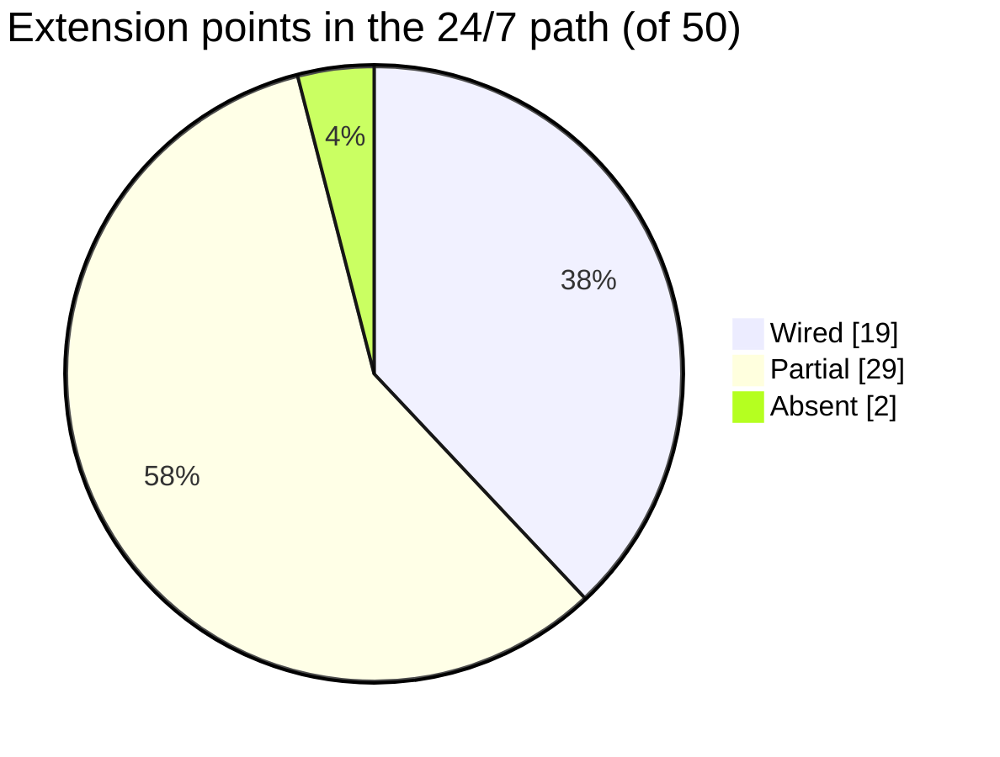

# 🔁 simplicio-loop

<p align="center">
  <a href="../docs/REPOSITORY_GOVERNANCE.md"></a>
  <a href="https://github.com/simpletibr/simplicio-loop/stargazers"></a>
  <a href="../docs/EXTENSION_POINTS_SERVICE.md"></a>
  <a href="../LICENSE"></a>
  <a href="https://discord.gg/wM6tr7xVb"></a>
</p>

<p align="center">
  <a href="../README.md">🇬🇧 English</a> |
  <a href="README.pt-BR.md">🇧🇷 Português</a> |
  <a href="README.es-ES.md">🇪🇸 Español</a> |
  <a href="README.fr-FR.md">🇫🇷 Français</a> |
  <a href="README.de-DE.md">🇩🇪 Deutsch</a> |
  <a href="README.it-IT.md">🇮🇹 Italiano</a> |
  <a href="README.ja-JP.md">🇯🇵 日本語</a> |
  <a href="README.ko-KR.md">🇰🇷 한국어</a> |
  <a href="README.zh-CN.md">🇨🇳 简体中文</a> |
  <a href="README.ru-RU.md">🇷🇺 Русский</a> |
  <a href="README.pl-PL.md">🇵🇱 Polski</a> |
  <a href="README.tr-TR.md">🇹🇷 Türkçe</a> |
  <a href="README.nl-NL.md">🇳🇱 Nederlands</a> |
  <a href="README.hi-IN.md">🇮🇳 हिन्दी</a> |
  <a href="README.ar-SA.md">🇸🇦 العربية</a>
</p>

**simplicio-loop तीन निर्धारक (deterministic) ऑपरेटर देता है जिन्हें कोई भी एजेंट हार्नेस सामान्य टूल की तरह कॉल कर सकता है: `simplicio-mapper` रिपो का नक्शा बनाता है, `simplicio-dev-cli` एडिट प्लान को ठीक-ठीक लागू करता है, और प्रभाव-आधारित टेस्ट चयन (`scripts/impact_tests.py`) केवल वही टेस्ट चलाता है जहाँ तक बदलाव पहुँचता है। GitHub issues को परखे गए PR में बदलने वाला लूप इनका एक उपभोक्ता है।**

<p align="center">
  
</p>

<p align="center">
  
</p>

## ऑपरेटर

एजेंट को लूप में चलाना अब कठिन हिस्सा नहीं है: एजेंट SDK और फ्रेमवर्क यह पहले से देते हैं। जो हिस्सा प्रायिकतात्मक (probabilistic) नहीं होना चाहिए वह है रिपो पढ़ना, बदलाव लिखना और टेस्ट चुनना। ये तीन टूल वही काम करते हैं, इनमें से कोई मॉडल नहीं चलाता, और हर एक मशीन-पठनीय आउटपुट देता है। आपका एजेंट (Claude Code, Codex, Cursor, LangGraph ग्राफ़, शेल स्क्रिप्ट) तय करता है; ये उसे लागू करते हैं।

| ऑपरेटर | क्या करता है | किसी भी हार्नेस से कॉल करें |
| --- | --- | --- |
| `simplicio-mapper` (survey) | रिपो को स्थानीय रूप से, बिना LLM के, पढ़ता है और पूरे ट्री के बजाय किसी लक्ष्य के लिए सीमित संदर्भ पैक लौटाता है। [Docs](../packages/mapper/README.md) | `simplicio-mapper handoff . --goal "trace the authentication flow" --token-budget 1200 --json` |
| `simplicio-dev-cli` (निर्धारक अनुप्रयोग) | find/replace एडिट प्लान लागू करता है जिसमें हर `find` ठीक एक बार मेल खाना चाहिए, सीमित सत्यापन चलाता है और एक JSON रसीद प्रिंट करता है। अपने README के अनुसार यह LLM प्रदान नहीं करता। [Docs](../packages/dev-cli/README.md) | `simplicio-dev-cli edit --root . --plan plan.json --apply --check "<tests>" --json` |
| प्रभाव-आधारित टेस्ट चयन | `scripts/impact_tests.py` कार्यशील ट्री की तुलना बेस रेफ़रेंस से सिंबल स्तर पर करता है और उन टेस्ट फ़ाइलों को चुनता है जो बदले गए फ़ंक्शन, क्लास या असाइनमेंट तक पहुँचती हैं। `scripts/check.py` इसका उपयोग करता है, इसलिए बदलाव केवल वही टेस्ट चलाता है जो प्रभावित हो सकते हैं। [Docs](../docs/GUIDE.md#-tests--local-checks-no-paid-ci) | `python3 scripts/impact_tests.py --base origin/main --json` |

`pip install simplicio-loop` से `simplicio-mapper` और `simplicio-dev-cli` आपके PATH पर आ जाते हैं (एक ही wheel, Python 3.11+)। `scripts/impact_tests.py` बिना इंस्टॉलेशन चरण वाली standard-library स्क्रिप्ट है: इसे checkout से चलाएँ या अपने रिपो में कॉपी करें।

यह README कोई बचत का आँकड़ा नहीं देता। माप [bench/llm_ab](../bench/llm_ab/README.md) में हैं, जहाँ प्रति रन कच्चे परिणाम `bench/llm_ab/results/` में हैं (छोटा A/B, एक मॉडल); जो वहाँ नहीं मापा गया, उसका दावा नहीं किया जाता।

## लूप इनमें से एक उपभोक्ता है

लूप संदर्भ उपभोक्ता है: यह एक GitHub issue लेता है, mapper से रिपो का नक्शा बनवाता है, sandbox में एक planner से JSON प्लान लिखवाता है, वह प्लान `simplicio-dev-cli` को देता है, टेस्ट चलाता है (इस रिपो में `scripts/check.py` प्रभाव-चयनित उपसमुच्चय चलाता है) और फिर PR खोलता है। लूप की जगह कोई दूसरा हार्नेस रखें, तो ऑपरेटर उसी तरह काम करते हैं।



## इंस्टॉलेशन

Python 3.11+, `git`, और GitHub issues के लिए प्रमाणित `gh` चाहिए।

```bash
pip install simplicio-loop
simplicio-loop install            # skills + hooks in this project (--global: user-wide, --host <name>: another host)
simplicio-loop doctor             # check the installed stack
```

## उपयोग

**Claude Code या VS Code में:**

```text
/simplicio-loop finish all the open issues
```

**24/7 watcher के रूप में** (एक सेवा जो `simpletibr/simplicio-*` repos पर नज़र रखती है और PR खोलती है):

```bash
simplicio-loop watch247 --once --dry-run          # one simulated tick, changes nothing
simplicio-loop watch247 login-check               # are the exec CLIs logged in?
# from a repo checkout, as root, after creating the non-root user simplicio-loop:
sudo cp packaging/systemd/simplicio-loop-247.service /etc/systemd/system/
sudo cp packaging/systemd/simplicio-loop-247.env.example /etc/simplicio-loop-247.env   # edit it, then chmod 600
sudo systemctl enable --now simplicio-loop-247
```

विवरण: [docs/WATCHER_247.md](../docs/WATCHER_247.md)।



## यह कैसे काम करता है

<p align="center">
  
</p>



<p align="center">
  
</p>



<p align="center">
  
</p>



<p align="center">
  
</p>

## 50 एक्सटेंशन पॉइंट



[docs/EXTENSION_POINTS_SERVICE.md](../docs/EXTENSION_POINTS_SERVICE.md) · [#1509](https://github.com/simpletibr/simplicio-loop/issues/1509)

## रनटाइम

- **6 `wired`** एडैप्टर `adapters/` में कोड और एक होस्ट टेस्ट रखते हैं: Claude Code, Codex, Cursor, Grok, Kiro और VS Code।
- **29 `listed`** होस्ट वे कैटलॉग प्रविष्टियाँ हैं जिनका README है और एडैप्टर कोड नहीं है; इनमें से 28 के पास एक सामान्य इंस्टॉलेशन लक्ष्य भी है जो skills और होस्ट की एंट्री फ़ाइल लिखता है। सूची में होना यह साबित नहीं करता कि होस्ट लूप चलाता है।
- ऊपर के ऑपरेटर सामान्य कमांड हैं, इसलिए वे किसी भी हार्नेस से चलते हैं, `wired` हो या न हो। हर होस्ट की स्थिति: [adapters/MATRIX.md](../adapters/MATRIX.md) और [simplicio_loop/_catalog/harnesses.json](../simplicio_loop/_catalog/harnesses.json)।

## और जानें

- [INSTALL.md](../INSTALL.md) · [docs/CLI_COMMANDS.md](../docs/CLI_COMMANDS.md) · [docs/WATCHER_247.md](../docs/WATCHER_247.md)
- [docs/MODEL_ROLES.md](../docs/MODEL_ROLES.md) · [docs/DASHBOARD.md](../docs/DASHBOARD.md) · [CHANGELOG.md](../CHANGELOG.md)
- **बाकी सब कुछ: [docs/GUIDE.md](../docs/GUIDE.md)** (skills, runtimes, loop, token बचत, सुरक्षा, टेस्ट; अंग्रेज़ी में)
