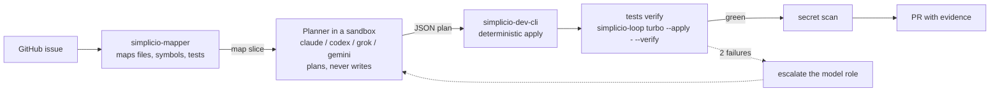
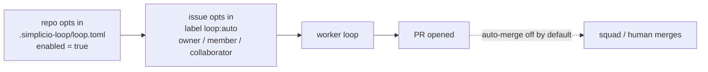
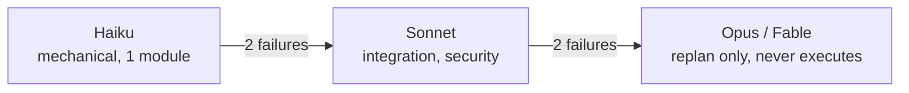
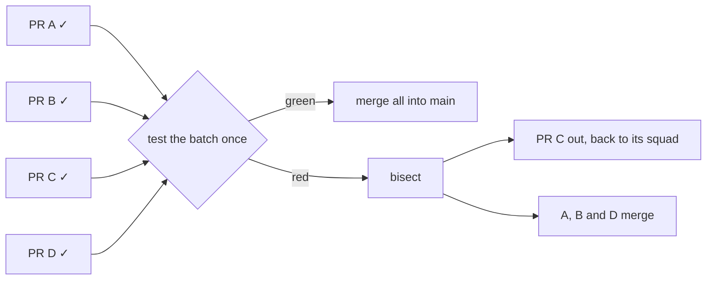
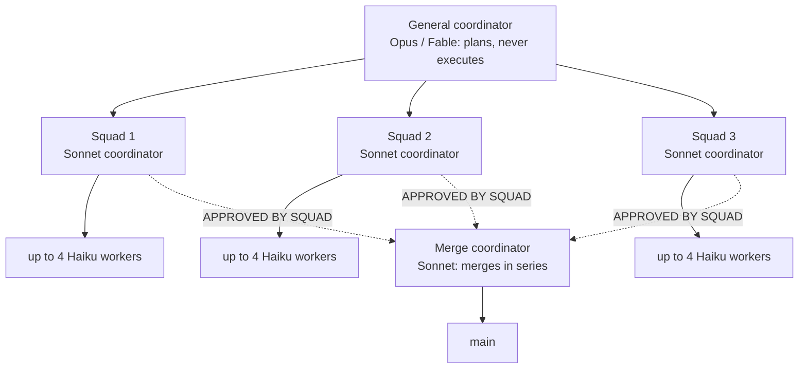
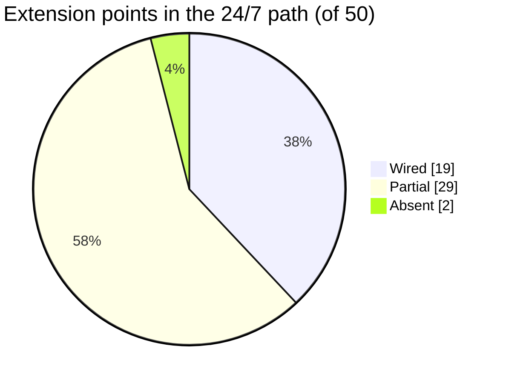

# 🔁 simplicio-loop

<p align="center">
  <a href="../docs/REPOSITORY_GOVERNANCE.md"></a>
  <a href="https://github.com/simpletibr/simplicio-loop/stargazers"></a>
  <a href="../docs/EXTENSION_POINTS_SERVICE.md"></a>
  <a href="../LICENSE"></a>
  <a href="https://discord.gg/wM6tr7xVb"></a>
</p>

<p align="center">
  <a href="../README.md">🇬🇧 English</a> |
  <a href="README.pt-BR.md">🇧🇷 Português</a> |
  <a href="README.es-ES.md">🇪🇸 Español</a> |
  <a href="README.fr-FR.md">🇫🇷 Français</a> |
  <a href="README.de-DE.md">🇩🇪 Deutsch</a> |
  <a href="README.it-IT.md">🇮🇹 Italiano</a> |
  <a href="README.ja-JP.md">🇯🇵 日本語</a> |
  <a href="README.ko-KR.md">🇰🇷 한국어</a> |
  <a href="README.zh-CN.md">🇨🇳 简体中文</a> |
  <a href="README.ru-RU.md">🇷🇺 Русский</a> |
  <a href="README.pl-PL.md">🇵🇱 Polski</a> |
  <a href="README.tr-TR.md">🇹🇷 Türkçe</a> |
  <a href="README.nl-NL.md">🇳🇱 Nederlands</a> |
  <a href="README.hi-IN.md">🇮🇳 हिन्दी</a> |
  <a href="README.ar-SA.md">🇸🇦 العربية</a>
</p>

**simplicio-loop offre tre operatori deterministici che qualsiasi harness di agenti può chiamare come strumenti: `simplicio-mapper` mappa il repo, `simplicio-dev-cli` applica un piano di modifica esattamente, e la selezione dei test per impatto (`scripts/impact_tests.py`) esegue solo i test che una modifica raggiunge. Il loop che trasforma le issue di GitHub in PR testate è uno dei loro consumatori.**

<p align="center">
  
</p>

<p align="center">
  
</p>

## Gli operatori

Far girare un agente in un loop non è più la parte difficile: SDK e framework per agenti lo offrono già. La parte che non deve essere probabilistica è leggere il repo, scrivere la modifica e scegliere i test. Questi tre strumenti fanno quel lavoro, nessuno di essi fornisce un modello e ognuno stampa output leggibile da macchina. Il tuo agente (Claude Code, Codex, Cursor, un grafo LangGraph, uno script shell) decide; loro eseguono.

| Operatore | Cosa fa | Richiamabile da qualsiasi harness |
| --- | --- | --- |
| `simplicio-mapper` (survey) | Scorre il repo in locale, senza LLM, e restituisce un pacchetto di contesto limitato per un obiettivo invece dell'intero albero. [Docs](../packages/mapper/README.md) | `simplicio-mapper handoff . --goal "trace the authentication flow" --token-budget 1200 --json` |
| `simplicio-dev-cli` (applicazione deterministica) | Applica un piano di modifica find/replace in cui ogni `find` deve corrispondere esattamente una volta, esegue una verifica circoscritta e stampa una ricevuta JSON. Non fornisce un LLM, secondo il proprio README. [Docs](../packages/dev-cli/README.md) | `simplicio-dev-cli edit --root . --plan plan.json --apply --check "<tests>" --json` |
| Selezione dei test per impatto | `scripts/impact_tests.py` confronta l'albero di lavoro con un ref di base a livello di simbolo e seleziona i file di test che raggiungono una funzione, classe o assegnazione modificata. `scripts/check.py` lo usa, quindi una modifica esegue solo i test che può influenzare. [Docs](../docs/GUIDE.md#-tests--local-checks-no-paid-ci) | `python3 scripts/impact_tests.py --base origin/main --json` |

`pip install simplicio-loop` mette `simplicio-mapper` e `simplicio-dev-cli` nel PATH (un'unica wheel, Python 3.11+). `scripts/impact_tests.py` è uno script della libreria standard senza passaggi di installazione: eseguilo da un checkout o copialo nel tuo repo.

Questo README non riporta alcuna cifra di risparmio. Le misure sono in [bench/llm_ab](../bench/llm_ab/README.md), dove i risultati grezzi per esecuzione sono in `bench/llm_ab/results/` (A/B piccolo, un solo modello); ciò che non è misurato lì non viene affermato.

## Il loop è uno dei suoi consumatori

Il loop è il consumatore di riferimento: prende una issue di GitHub, fa mappare il repo a mapper, lascia che un pianificatore in sandbox scriva un piano JSON, consegna il piano a `simplicio-dev-cli`, esegue i test (in questo repo, `scripts/check.py` esegue il sottoinsieme selezionato per impatto) e poi apre una PR. Sostituisci il loop con un altro harness e gli operatori funzionano allo stesso modo.



## Installazione

Richiede Python 3.11+, `git` e un `gh` autenticato per le issue di GitHub.

```bash
pip install simplicio-loop
simplicio-loop install            # skills + hooks in this project (--global: user-wide, --host <name>: another host)
simplicio-loop doctor             # check the installed stack
```

## Uso

**In Claude Code o VS Code:**

```text
/simplicio-loop finish all the open issues
```

**Come watcher 24/7** (un servizio che osserva i repo `simpletibr/simplicio-*` e apre PR):

```bash
simplicio-loop watch247 --once --dry-run          # one simulated tick, changes nothing
simplicio-loop watch247 login-check               # are the exec CLIs logged in?
# from a repo checkout, as root, after creating the non-root user simplicio-loop:
sudo cp packaging/systemd/simplicio-loop-247.service /etc/systemd/system/
sudo cp packaging/systemd/simplicio-loop-247.env.example /etc/simplicio-loop-247.env   # edit it, then chmod 600
sudo systemctl enable --now simplicio-loop-247
```

Dettagli: [docs/WATCHER_247.md](../docs/WATCHER_247.md).



## Come funziona

<p align="center">
  
</p>



<p align="center">
  
</p>



<p align="center">
  
</p>



<p align="center">
  
</p>

## I 50 punti di estensione



[docs/EXTENSION_POINTS_SERVICE.md](../docs/EXTENSION_POINTS_SERVICE.md) · [#1509](https://github.com/simpletibr/simplicio-loop/issues/1509)

## Runtime

- **6 `wired`** adapter contengono codice in `adapters/` e un test di host: Claude Code, Codex, Cursor, Grok, Kiro e VS Code.
- **29 `listed`** host sono voci del catalogo con README e senza codice di adapter; 28 di loro hanno anche un target di installazione generico che scrive le skill e il file di ingresso dell'host. Essere elencato non prova che l'host esegua il loop.
- Gli operatori sopra sono comandi semplici, quindi funzionano da qualsiasi harness, `wired` o no. Stato per host: [adapters/MATRIX.md](../adapters/MATRIX.md) e [simplicio_loop/_catalog/harnesses.json](../simplicio_loop/_catalog/harnesses.json).

## Per saperne di più

- [INSTALL.md](../INSTALL.md) · [docs/CLI_COMMANDS.md](../docs/CLI_COMMANDS.md) · [docs/WATCHER_247.md](../docs/WATCHER_247.md)
- [docs/MODEL_ROLES.md](../docs/MODEL_ROLES.md) · [docs/DASHBOARD.md](../docs/DASHBOARD.md) · [CHANGELOG.md](../CHANGELOG.md)
- **Tutto il resto: [docs/GUIDE.md](../docs/GUIDE.md)** (skill, runtime, il loop, risparmio di token, sicurezza, test; in inglese)
