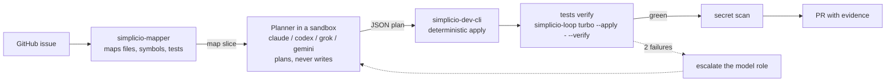
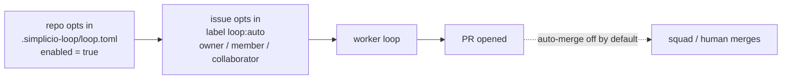
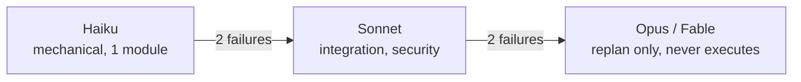
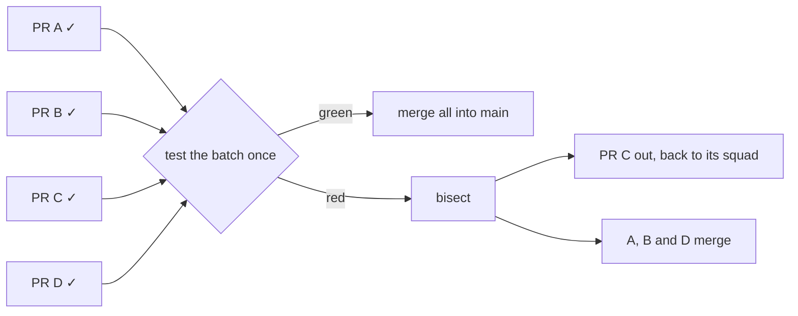
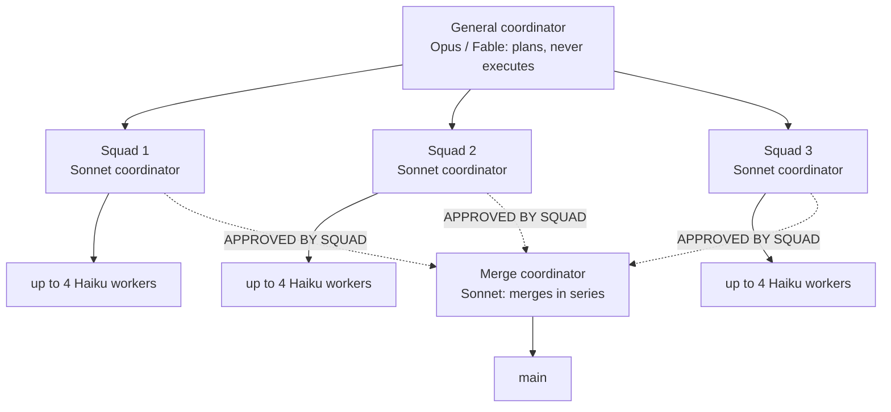
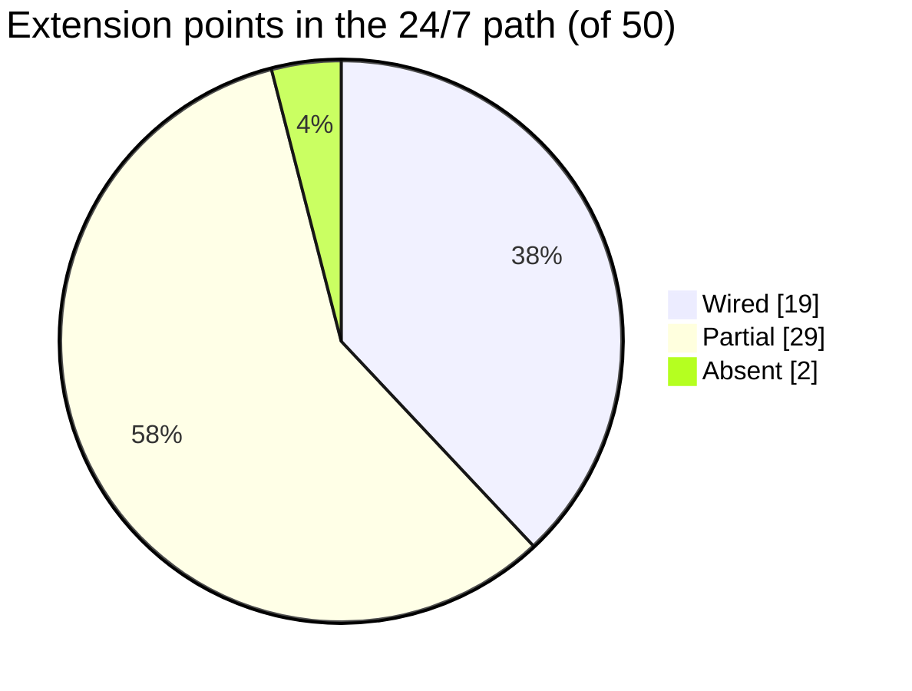

# 🔁 simplicio-loop

<p align="center">
  <a href="../docs/REPOSITORY_GOVERNANCE.md"></a>
  <a href="https://github.com/simpletibr/simplicio-loop/stargazers"></a>
  <a href="../docs/EXTENSION_POINTS_SERVICE.md"></a>
  <a href="../LICENSE"></a>
  <a href="https://discord.gg/wM6tr7xVb"></a>
</p>

<p align="center">
  <a href="../README.md">🇬🇧 English</a> |
  <a href="README.pt-BR.md">🇧🇷 Português</a> |
  <a href="README.es-ES.md">🇪🇸 Español</a> |
  <a href="README.fr-FR.md">🇫🇷 Français</a> |
  <a href="README.de-DE.md">🇩🇪 Deutsch</a> |
  <a href="README.it-IT.md">🇮🇹 Italiano</a> |
  <a href="README.ja-JP.md">🇯🇵 日本語</a> |
  <a href="README.ko-KR.md">🇰🇷 한국어</a> |
  <a href="README.zh-CN.md">🇨🇳 简体中文</a> |
  <a href="README.ru-RU.md">🇷🇺 Русский</a> |
  <a href="README.pl-PL.md">🇵🇱 Polski</a> |
  <a href="README.tr-TR.md">🇹🇷 Türkçe</a> |
  <a href="README.nl-NL.md">🇳🇱 Nederlands</a> |
  <a href="README.hi-IN.md">🇮🇳 हिन्दी</a> |
  <a href="README.ar-SA.md">🇸🇦 العربية</a>
</p>

**simplicio-loopは、どのエージェントハーネスからも通常のツールとして呼び出せる3つの決定的オペレーターを提供します。`simplicio-mapper`はリポジトリを調査し、`simplicio-dev-cli`は編集計画を正確に適用し、影響ベースのテスト選択（`scripts/impact_tests.py`）は変更が及ぶテストだけを実行します。GitHubのissueをテスト済みのPRに変えるループは、その利用者の一つです。**

<p align="center">
  
</p>

<p align="center">
  
</p>

## オペレーター

エージェントをループで回すことは、もはや難しい部分ではありません。エージェントSDKやフレームワークがすでに提供しています。確率的であってはならないのは、リポジトリの読み取り、編集の書き込み、テストの選択です。この3つのツールがその作業を担い、どれもモデルを呼び出さず、それぞれ機械可読な出力を返します。エージェント（Claude Code、Codex、Cursor、LangGraphのグラフ、シェルスクリプトなど）が判断し、これらが実行します。

| オペレーター | 役割 | どのハーネスからでも呼べる |
| --- | --- | --- |
| `simplicio-mapper`（survey） | リポジトリをローカルで（LLMなしで）走査し、全体のツリーではなく目的に対する上限付きのコンテキストパックを返します。[Docs](../packages/mapper/README.md) | `simplicio-mapper handoff . --goal "trace the authentication flow" --token-budget 1200 --json` |
| `simplicio-dev-cli`（決定的な適用） | 各`find`がちょうど1回だけ一致しなければならない find/replace の編集計画を適用し、範囲を絞った検証を実行して JSON の受領書を1つ出力します。自身の README によれば LLM は提供しません。[Docs](../packages/dev-cli/README.md) | `simplicio-dev-cli edit --root . --plan plan.json --apply --check "<tests>" --json` |
| 影響ベースのテスト選択 | `scripts/impact_tests.py`は作業ツリーを基準refとシンボル単位で比較し、変更された関数・クラス・代入に到達するテストファイルを選びます。`scripts/check.py`がこれを使うため、変更は影響しうるテストだけを実行します。[Docs](../docs/GUIDE.md#-tests--local-checks-no-paid-ci) | `python3 scripts/impact_tests.py --base origin/main --json` |

`pip install simplicio-loop` で `simplicio-mapper` と `simplicio-dev-cli` が PATH に入ります（単一の wheel、Python 3.11+）。`scripts/impact_tests.py` は標準ライブラリだけで動くスクリプトでインストール手順はありません。checkout から実行するか、自分のリポジトリにコピーしてください。

この README は節約率の数値を載せていません。計測結果は [bench/llm_ab](../bench/llm_ab/README.md) にあり、実行ごとの生の結果は `bench/llm_ab/results/` にあります（小規模な A/B、単一モデル）。そこで計測されていないことは主張しません。

## ループはその利用者の一つ

ループは参照用の利用者です。GitHub の issue を受け取り、mapper にリポジトリの地図を作らせ、サンドボックス内のプランナーに JSON の計画を書かせ、その計画を `simplicio-dev-cli` に渡し、テストを実行してから（このリポジトリでは `scripts/check.py` が影響ベースで選ばれたサブセットを実行します）PR を開きます。ループを別のハーネスに置き換えても、オペレーターは同じように動きます。



## インストール

Python 3.11+、`git`、GitHub issue用に認証済みの`gh`が必要です。

```bash
pip install simplicio-loop
simplicio-loop install            # skills + hooks in this project (--global: user-wide, --host <name>: another host)
simplicio-loop doctor             # check the installed stack
```

## 使い方

**Claude CodeまたはVS Codeで:**

```text
/simplicio-loop finish all the open issues
```

**24時間365日のwatcherとして**（`simpletibr/simplicio-*`リポジトリを監視してPRを開くサービス）:

```bash
simplicio-loop watch247 --once --dry-run          # one simulated tick, changes nothing
simplicio-loop watch247 login-check               # are the exec CLIs logged in?
# from a repo checkout, as root, after creating the non-root user simplicio-loop:
sudo cp packaging/systemd/simplicio-loop-247.service /etc/systemd/system/
sudo cp packaging/systemd/simplicio-loop-247.env.example /etc/simplicio-loop-247.env   # edit it, then chmod 600
sudo systemctl enable --now simplicio-loop-247
```

詳細: [docs/WATCHER_247.md](../docs/WATCHER_247.md)。



## 仕組み

<p align="center">
  
</p>



<p align="center">
  
</p>



<p align="center">
  
</p>



<p align="center">
  
</p>

## 50の拡張ポイント



[docs/EXTENSION_POINTS_SERVICE.md](../docs/EXTENSION_POINTS_SERVICE.md) · [#1509](https://github.com/simpletibr/simplicio-loop/issues/1509)

## ランタイム

- **34 `wired`** アダプターは `adapters/` にコードとホストテストを持ちます。カタログのインストール対象ホストすべてが対象で、Claude Code、Codex、Cursor、Grok、Kiro、VS Code、20 の `AGENTS.md` ホスト、ウェーブ B の 8 ホストを含みます。
- **0 `listed`** ホスト: カタログの各ホストにはアダプターのコードがあります。DeepSeek はモデルプロバイダーであり、ホストではありません。
- 上のオペレーターは普通のコマンドなので、`wired` かどうかに関係なく、どのハーネスからでも動きます。ホストごとの状態：[adapters/MATRIX.md](../adapters/MATRIX.md) と [simplicio_loop/_catalog/harnesses.json](../simplicio_loop/_catalog/harnesses.json)。

## さらに詳しく

- [INSTALL.md](../INSTALL.md) · [docs/CLI_COMMANDS.md](../docs/CLI_COMMANDS.md) · [docs/WATCHER_247.md](../docs/WATCHER_247.md)
- [docs/MODEL_ROLES.md](../docs/MODEL_ROLES.md) · [docs/DASHBOARD.md](../docs/DASHBOARD.md) · [CHANGELOG.md](../CHANGELOG.md)
- **その他すべて: [docs/GUIDE.md](../docs/GUIDE.md)**（skills、runtimes、ループ、トークン節約、安全性、テスト、英語）
