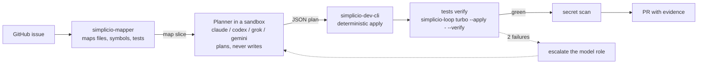
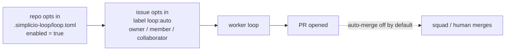
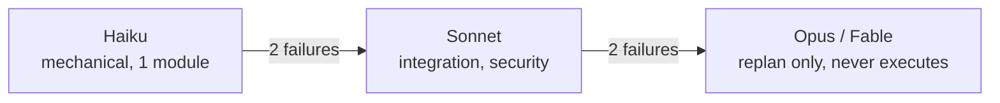
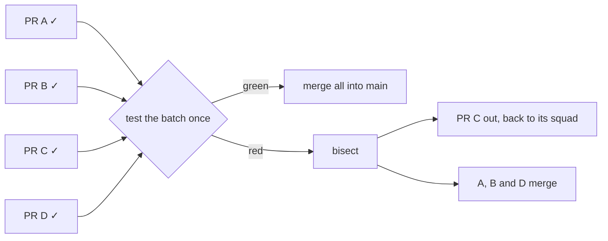
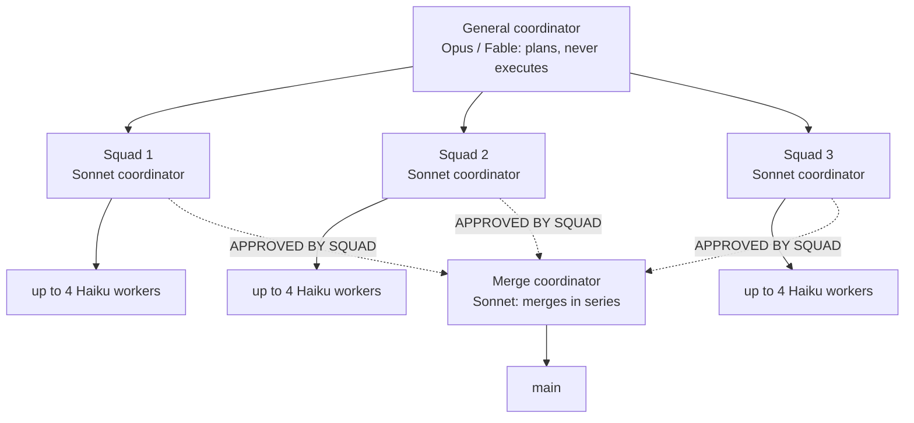
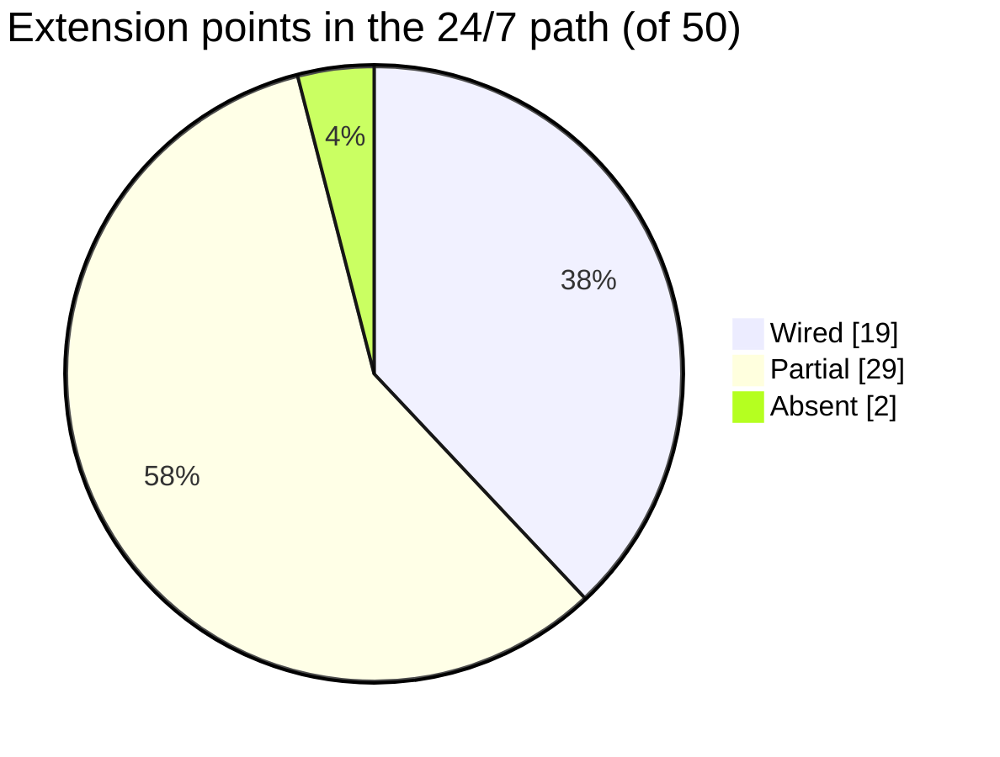

# 🔁 simplicio-loop

<p align="center">
  <a href="../docs/REPOSITORY_GOVERNANCE.md"></a>
  <a href="https://github.com/simpletibr/simplicio-loop/stargazers"></a>
  <a href="../docs/EXTENSION_POINTS_SERVICE.md"></a>
  <a href="../LICENSE"></a>
  <a href="https://discord.gg/wM6tr7xVb"></a>
</p>

<p align="center">
  <a href="../README.md">🇬🇧 English</a> |
  <a href="README.pt-BR.md">🇧🇷 Português</a> |
  <a href="README.es-ES.md">🇪🇸 Español</a> |
  <a href="README.fr-FR.md">🇫🇷 Français</a> |
  <a href="README.de-DE.md">🇩🇪 Deutsch</a> |
  <a href="README.it-IT.md">🇮🇹 Italiano</a> |
  <a href="README.ja-JP.md">🇯🇵 日本語</a> |
  <a href="README.ko-KR.md">🇰🇷 한국어</a> |
  <a href="README.zh-CN.md">🇨🇳 简体中文</a> |
  <a href="README.ru-RU.md">🇷🇺 Русский</a> |
  <a href="README.pl-PL.md">🇵🇱 Polski</a> |
  <a href="README.tr-TR.md">🇹🇷 Türkçe</a> |
  <a href="README.nl-NL.md">🇳🇱 Nederlands</a> |
  <a href="README.hi-IN.md">🇮🇳 हिन्दी</a> |
  <a href="README.ar-SA.md">🇸🇦 العربية</a>
</p>

**simplicio-loop는 어떤 에이전트 하네스에서도 일반 도구처럼 호출할 수 있는 세 가지 결정적 오퍼레이터를 제공합니다. `simplicio-mapper`는 저장소를 조사하고, `simplicio-dev-cli`는 편집 계획을 정확히 적용하며, 영향 기반 테스트 선택(`scripts/impact_tests.py`)은 변경이 닿는 테스트만 실행합니다. GitHub 이슈를 검증된 PR로 바꾸는 루프는 그 소비자 중 하나입니다.**

<p align="center">
  
</p>

<p align="center">
  
</p>

## 오퍼레이터

에이전트를 루프로 돌리는 것은 더 이상 어려운 부분이 아닙니다. 에이전트 SDK와 프레임워크가 이미 제공합니다. 확률적이면 안 되는 부분은 저장소 읽기, 편집 작성, 테스트 선택입니다. 이 세 도구가 그 일을 맡으며, 어느 것도 모델을 호출하지 않고 각각 기계가 읽을 수 있는 출력을 냅니다. 에이전트(Claude Code, Codex, Cursor, LangGraph 그래프, 셸 스크립트)가 결정하고, 이 도구들이 실행합니다.

| 오퍼레이터 | 하는 일 | 어떤 하네스에서든 호출 |
| --- | --- | --- |
| `simplicio-mapper` (survey) | 저장소를 로컬에서, LLM 없이 훑고 전체 트리 대신 목표에 맞는 제한된 컨텍스트 팩을 반환합니다. [Docs](../packages/mapper/README.md) | `simplicio-mapper handoff . --goal "trace the authentication flow" --token-budget 1200 --json` |
| `simplicio-dev-cli` (결정적 적용) | 각 `find`가 정확히 한 번만 일치해야 하는 find/replace 편집 계획을 적용하고, 범위가 정해진 검증을 실행한 뒤 JSON 영수증 하나를 출력합니다. 자체 README에 따르면 LLM을 제공하지 않습니다. [Docs](../packages/dev-cli/README.md) | `simplicio-dev-cli edit --root . --plan plan.json --apply --check "<tests>" --json` |
| 영향 기반 테스트 선택 | `scripts/impact_tests.py`는 작업 트리를 기준 ref와 심볼 수준에서 비교해, 변경된 함수·클래스·할당에 닿는 테스트 파일을 고릅니다. `scripts/check.py`가 이를 사용하므로 변경은 영향을 받을 수 있는 테스트만 실행합니다. [Docs](../docs/GUIDE.md#-tests--local-checks-no-paid-ci) | `python3 scripts/impact_tests.py --base origin/main --json` |

`pip install simplicio-loop`를 실행하면 `simplicio-mapper`와 `simplicio-dev-cli`가 PATH에 올라갑니다(휠 하나, Python 3.11+). `scripts/impact_tests.py`는 설치 단계가 없는 표준 라이브러리 스크립트입니다. 체크아웃에서 실행하거나 저장소에 복사해 사용하세요.

이 README는 절감 수치를 싣지 않습니다. 측정 결과는 [bench/llm_ab](../bench/llm_ab/README.md)에 있으며, 실행별 원본 결과는 `bench/llm_ab/results/`에 있습니다(소규모 A/B, 단일 모델). 거기서 측정되지 않은 내용은 주장하지 않습니다.

## 루프는 그 소비자 중 하나입니다

루프는 기준 소비자입니다. GitHub 이슈를 받아 mapper가 저장소 지도를 만들게 하고, 샌드박스의 플래너가 JSON 계획을 쓰게 한 뒤, 그 계획을 `simplicio-dev-cli`에 넘기고 테스트를 실행합니다(이 저장소에서는 `scripts/check.py`가 영향 기반으로 고른 부분집합을 실행합니다). 그 다음에야 PR을 엽니다. 루프를 다른 하네스로 바꿔도 오퍼레이터는 똑같이 동작합니다.



## 설치

Python 3.11+, `git`, 그리고 GitHub 이슈용으로 인증된 `gh`가 필요합니다.

```bash
pip install simplicio-loop
simplicio-loop install            # skills + hooks in this project (--global: user-wide, --host <name>: another host)
simplicio-loop doctor             # check the installed stack
```

## 사용법

**Claude Code 또는 VS Code에서:**

```text
/simplicio-loop finish all the open issues
```

**24/7 watcher로**(`simpletibr/simplicio-*` 저장소를 감시하고 PR을 열는 서비스):

```bash
simplicio-loop watch247 --once --dry-run          # one simulated tick, changes nothing
simplicio-loop watch247 login-check               # are the exec CLIs logged in?
# from a repo checkout, as root, after creating the non-root user simplicio-loop:
sudo cp packaging/systemd/simplicio-loop-247.service /etc/systemd/system/
sudo cp packaging/systemd/simplicio-loop-247.env.example /etc/simplicio-loop-247.env   # edit it, then chmod 600
sudo systemctl enable --now simplicio-loop-247
```

자세한 내용: [docs/WATCHER_247.md](../docs/WATCHER_247.md).



## 동작 방식

<p align="center">
  
</p>



<p align="center">
  
</p>



<p align="center">
  
</p>



<p align="center">
  
</p>

## 50개의 확장 포인트



[docs/EXTENSION_POINTS_SERVICE.md](../docs/EXTENSION_POINTS_SERVICE.md) · [#1509](https://github.com/simpletibr/simplicio-loop/issues/1509)

## 런타임

- **6 `wired`** 어댑터는 `adapters/`에 코드가 있고 호스트 테스트가 있습니다: Claude Code, Codex, Cursor, Grok, Kiro, VS Code.
- **29 `listed`** 호스트는 README가 있는 카탈로그 항목이며 어댑터 코드는 없습니다. 이 중 28개에는 skills와 호스트의 진입 파일을 쓰는 일반 설치 대상도 있습니다. 목록에 있다고 해서 그 호스트가 루프를 실행한다는 증거는 아닙니다.
- 위의 오퍼레이터는 평범한 명령이므로 `wired`인지와 관계없이 어떤 하네스에서든 동작합니다. 호스트별 상태: [adapters/MATRIX.md](../adapters/MATRIX.md), [simplicio_loop/_catalog/harnesses.json](../simplicio_loop/_catalog/harnesses.json).

## 더 알아보기

- [INSTALL.md](../INSTALL.md) · [docs/CLI_COMMANDS.md](../docs/CLI_COMMANDS.md) · [docs/WATCHER_247.md](../docs/WATCHER_247.md)
- [docs/MODEL_ROLES.md](../docs/MODEL_ROLES.md) · [docs/DASHBOARD.md](../docs/DASHBOARD.md) · [CHANGELOG.md](../CHANGELOG.md)
- **나머지 모든 것: [docs/GUIDE.md](../docs/GUIDE.md)**(skills, runtimes, 루프, 토큰 절약, 보안, 테스트, 영어)
