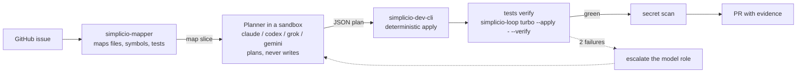
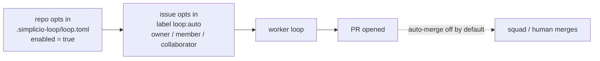
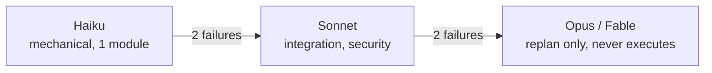
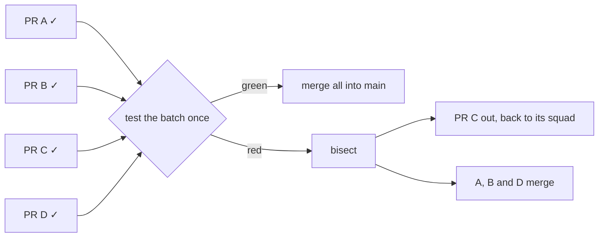
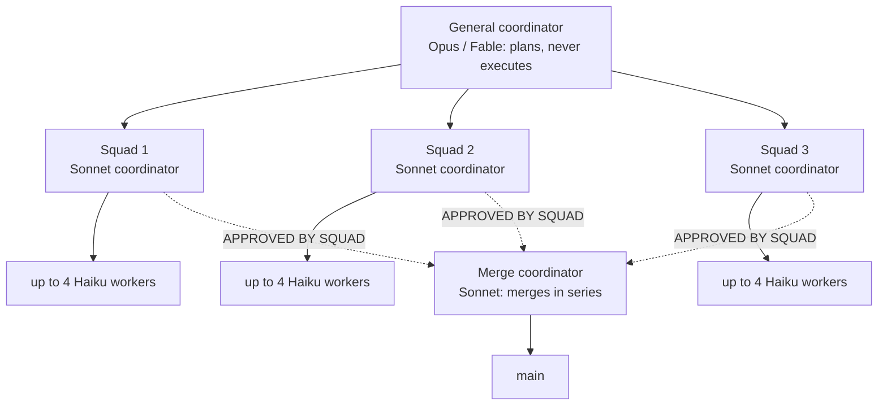
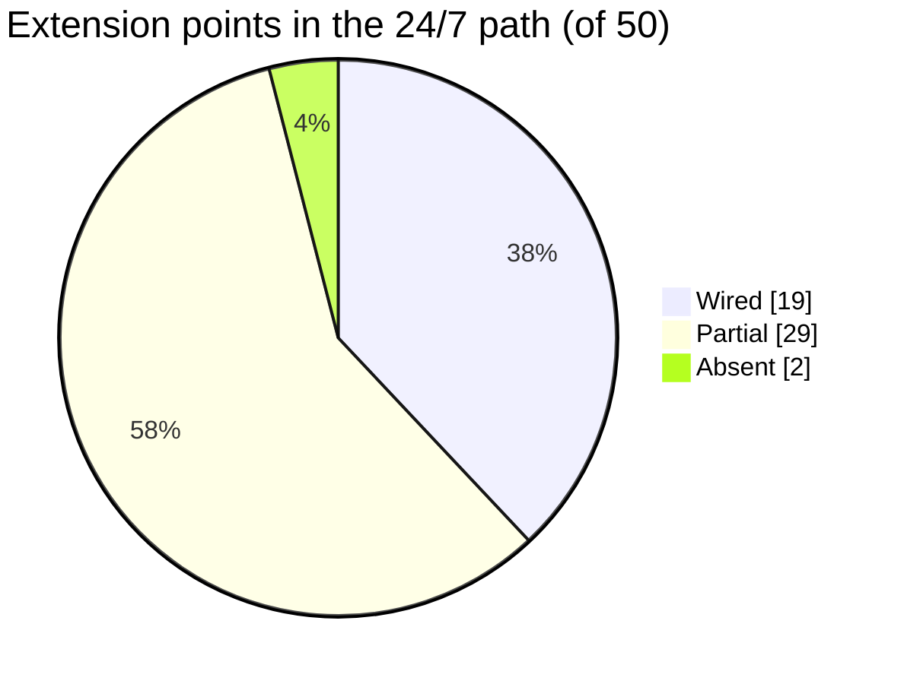

# 🔁 simplicio-loop

<p align="center">
  <a href="../docs/REPOSITORY_GOVERNANCE.md"></a>
  <a href="https://github.com/simpletibr/simplicio-loop/stargazers"></a>
  <a href="../docs/EXTENSION_POINTS_SERVICE.md"></a>
  <a href="../LICENSE"></a>
  <a href="https://discord.gg/wM6tr7xVb"></a>
</p>

<p align="center">
  <a href="../README.md">🇬🇧 English</a> |
  <a href="README.pt-BR.md">🇧🇷 Português</a> |
  <a href="README.es-ES.md">🇪🇸 Español</a> |
  <a href="README.fr-FR.md">🇫🇷 Français</a> |
  <a href="README.de-DE.md">🇩🇪 Deutsch</a> |
  <a href="README.it-IT.md">🇮🇹 Italiano</a> |
  <a href="README.ja-JP.md">🇯🇵 日本語</a> |
  <a href="README.ko-KR.md">🇰🇷 한국어</a> |
  <a href="README.zh-CN.md">🇨🇳 简体中文</a> |
  <a href="README.ru-RU.md">🇷🇺 Русский</a> |
  <a href="README.pl-PL.md">🇵🇱 Polski</a> |
  <a href="README.tr-TR.md">🇹🇷 Türkçe</a> |
  <a href="README.nl-NL.md">🇳🇱 Nederlands</a> |
  <a href="README.hi-IN.md">🇮🇳 हिन्दी</a> |
  <a href="README.ar-SA.md">🇸🇦 العربية</a>
</p>

**simplicio-loop dostarcza trzy deterministyczne operatory, które każdy harness agenta może wywołać jak zwykłe narzędzia: `simplicio-mapper` mapuje repo, `simplicio-dev-cli` stosuje plan edycji dokładnie, a wybór testów wg wpływu (`scripts/impact_tests.py`) uruchamia tylko testy, do których zmiana sięga. Pętla, która zamienia issue z GitHuba w przetestowane PR-y, jest jednym z ich konsumentów.**

<p align="center">
  
</p>

<p align="center">
  
</p>

## Operatory

Uruchomienie agenta w pętli nie jest już najtrudniejszą częścią: SDK i frameworki agentów to już oferują. Nie może być probabilistyczne czytanie repo, zapis edycji i dobór testów. Te trzy narzędzia wykonują tę pracę, żadne nie uruchamia modelu, a każde drukuje wynik czytelny dla maszyn. Twój agent (Claude Code, Codex, Cursor, graf LangGraph, skrypt shellowy) decyduje; one wykonują.

| Operator | Co robi | Wywoływalny z dowolnego harnessu |
| --- | --- | --- |
| `simplicio-mapper` (survey) | Przechodzi repo lokalnie, bez LLM, i zwraca ograniczony pakiet kontekstu dla celu zamiast całego drzewa. [Docs](../packages/mapper/README.md) | `simplicio-mapper handoff . --goal "trace the authentication flow" --token-budget 1200 --json` |
| `simplicio-dev-cli` (deterministyczne zastosowanie) | Stosuje plan edycji find/replace, w którym każde `find` musi pasować dokładnie raz, uruchamia ograniczoną weryfikację i drukuje jeden paragon JSON. Według własnego README nie uruchamia LLM. [Docs](../packages/dev-cli/README.md) | `simplicio-dev-cli edit --root . --plan plan.json --apply --check "<tests>" --json` |
| Wybór testów wg wpływu | `scripts/impact_tests.py` porównuje drzewo robocze z referencją bazową na poziomie symboli i wybiera pliki testów, które sięgają zmienionej funkcji, klasy lub przypisania. `scripts/check.py` z niego korzysta, więc zmiana uruchamia tylko testy, na które może wpłynąć. [Docs](../docs/GUIDE.md#-tests--local-checks-no-paid-ci) | `python3 scripts/impact_tests.py --base origin/main --json` |

`pip install simplicio-loop` umieszcza `simplicio-mapper` i `simplicio-dev-cli` w PATH (jedno wheel, Python 3.11+). `scripts/impact_tests.py` to skrypt biblioteki standardowej bez kroku instalacji: uruchom go z checkoutu lub skopiuj do swojego repo.

Ten README nie podaje żadnej liczby oszczędności. Pomiary są w [bench/llm_ab](../bench/llm_ab/README.md), a surowe wyniki poszczególnych uruchomień w `bench/llm_ab/results/` (mały test A/B, jeden model); tego, czego tam nie zmierzono, nie twierdzimy.

## Pętla jest jednym z jej konsumentów

Pętla jest konsumentem referencyjnym: bierze issue z GitHuba, każe mapperowi zmapować repo, pozwala plannerowi w sandboksie napisać plan JSON, przekazuje plan do `simplicio-dev-cli`, uruchamia testy (w tym repo `scripts/check.py` uruchamia podzbiór wybrany wg wpływu) i dopiero potem otwiera PR. Zamień pętlę na inny harness, a operatory działają tak samo.



## Instalacja

Wymaga Pythona 3.11+, `git` oraz uwierzytelnionego `gh` dla issues na GitHubie.

```bash
pip install simplicio-loop
simplicio-loop install            # skills + hooks in this project (--global: user-wide, --host <name>: another host)
simplicio-loop doctor             # check the installed stack
```

## Użycie

**W Claude Code lub VS Code:**

```text
/simplicio-loop finish all the open issues
```

**Jako watcher 24/7** (usługa, która obserwuje repo `simpletibr/simplicio-*` i otwiera PR-y):

```bash
simplicio-loop watch247 --once --dry-run          # one simulated tick, changes nothing
simplicio-loop watch247 login-check               # are the exec CLIs logged in?
# from a repo checkout, as root, after creating the non-root user simplicio-loop:
sudo cp packaging/systemd/simplicio-loop-247.service /etc/systemd/system/
sudo cp packaging/systemd/simplicio-loop-247.env.example /etc/simplicio-loop-247.env   # edit it, then chmod 600
sudo systemctl enable --now simplicio-loop-247
```

Szczegóły: [docs/WATCHER_247.md](../docs/WATCHER_247.md).



## Jak to działa

<p align="center">
  
</p>



<p align="center">
  
</p>



<p align="center">
  
</p>



<p align="center">
  
</p>

## 50 punktów rozszerzenia



[docs/EXTENSION_POINTS_SERVICE.md](../docs/EXTENSION_POINTS_SERVICE.md) · [#1509](https://github.com/simpletibr/simplicio-loop/issues/1509)

## Runtime'y

- **34 `wired`** adaptery mają kod w `adapters/` i test hosta: każdy host instalacji z katalogu, w tym Claude Code, Codex, Cursor, Grok, Kiro, VS Code, 20 `AGENTS.md` i osiem z fali B.
- **0 `listed`** hostów: każdy host z katalogu ma kod adaptera. DeepSeek to dostawca modeli, nie host.
- Operatory powyżej to zwykłe polecenia, więc działają z każdego harnessu, `wired` czy nie. Status każdego hosta: [adapters/MATRIX.md](../adapters/MATRIX.md) i [simplicio_loop/_catalog/harnesses.json](../simplicio_loop/_catalog/harnesses.json).

## Dowiedz się więcej

- [INSTALL.md](../INSTALL.md) · [docs/CLI_COMMANDS.md](../docs/CLI_COMMANDS.md) · [docs/WATCHER_247.md](../docs/WATCHER_247.md)
- [docs/MODEL_ROLES.md](../docs/MODEL_ROLES.md) · [docs/DASHBOARD.md](../docs/DASHBOARD.md) · [CHANGELOG.md](../CHANGELOG.md)
- **Wszystko inne: [docs/GUIDE.md](../docs/GUIDE.md)** (skills, runtimes, pętla, oszczędność tokenów, bezpieczeństwo, testy; po angielsku)
