# 🔁 simplicio-loop

<p align="center">
  <a href="../docs/REPOSITORY_GOVERNANCE.md"></a>
  <a href="https://github.com/simpletibr/simplicio-loop/stargazers"></a>
  <a href="../docs/EXTENSION_POINTS_SERVICE.md"></a>
  <a href="../LICENSE"></a>
  <a href="https://discord.gg/wM6tr7xVb"></a>
</p>

<p align="center">
  <a href="../README.md">🇬🇧 English</a> |
  <a href="README.pt-BR.md">🇧🇷 Português</a> |
  <a href="README.es-ES.md">🇪🇸 Español</a> |
  <a href="README.fr-FR.md">🇫🇷 Français</a> |
  <a href="README.de-DE.md">🇩🇪 Deutsch</a> |
  <a href="README.it-IT.md">🇮🇹 Italiano</a> |
  <a href="README.ja-JP.md">🇯🇵 日本語</a> |
  <a href="README.ko-KR.md">🇰🇷 한국어</a> |
  <a href="README.zh-CN.md">🇨🇳 简体中文</a> |
  <a href="README.ru-RU.md">🇷🇺 Русский</a> |
  <a href="README.pl-PL.md">🇵🇱 Polski</a> |
  <a href="README.tr-TR.md">🇹🇷 Türkçe</a> |
  <a href="README.nl-NL.md">🇳🇱 Nederlands</a> |
  <a href="README.hi-IN.md">🇮🇳 हिन्दी</a> |
  <a href="README.ar-SA.md">🇸🇦 العربية</a>
</p>

**simplicio-loop, her agent harness'ın sıradan araç gibi çağırabileceği üç deterministik operatör sunar: `simplicio-mapper` depoyu haritalar, `simplicio-dev-cli` bir düzenleme planını birebir uygular ve etki tabanlı test seçimi (`scripts/impact_tests.py`) yalnızca bir değişikliğin ulaştığı testleri çalıştırır. GitHub issue'larını test edilmiş PR'lara dönüştüren döngü bunların tüketicilerinden biridir.**

<p align="center">
  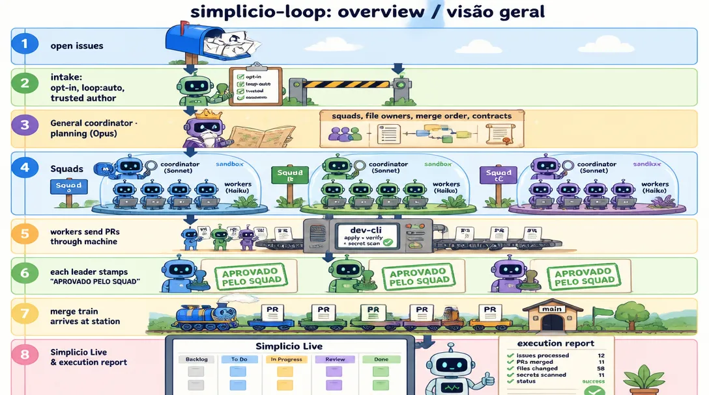
</p>

<p align="center">
  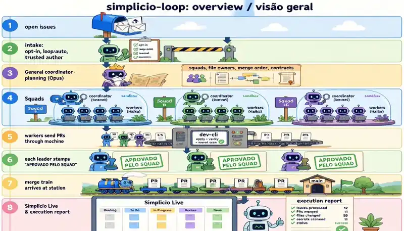
</p>

## Operatörler

Bir ajanı döngüde çalıştırmak artık zor kısım değil: ajan SDK'ları ve framework'leri bunu zaten sunuyor. Olasılıksal olmaması gereken kısım depoyu okumak, düzenlemeyi yazmak ve testleri seçmek. Bu üç araç o işi yapar, hiçbiri bir model çalıştırmaz ve her biri makine tarafından okunabilir çıktı basar. Ajanınız (Claude Code, Codex, Cursor, bir LangGraph grafiği, bir shell betiği) karar verir; onlar uygular.

| Operatör | Ne yapar | Herhangi bir harness'ten çağrılabilir |
| --- | --- | --- |
| `simplicio-mapper` (survey) | Depoyu yerel olarak, LLM kullanmadan tarar ve tüm ağaç yerine bir hedef için sınırlı bir bağlam paketi döndürür. [Docs](../packages/mapper/README.md) | `simplicio-mapper handoff . --goal "trace the authentication flow" --token-budget 1200 --json` |
| `simplicio-dev-cli` (deterministik uygulama) | Her `find` kısmının tam bir kez eşleşmesi gereken bir find/replace düzenleme planını uygular, sınırlı bir doğrulama çalıştırır ve tek bir JSON makbuzu basar. Kendi README'sine göre bir LLM sağlamaz. [Docs](../packages/dev-cli/README.md) | `simplicio-dev-cli edit --root . --plan plan.json --apply --check "<tests>" --json` |
| Etki tabanlı test seçimi | `scripts/impact_tests.py` çalışma ağacını bir temel referansla sembol düzeyinde karşılaştırır ve değişen bir fonksiyona, sınıfa veya atamaya ulaşan test dosyalarını seçer. `scripts/check.py` bunu kullanır; böylece bir değişiklik yalnızca etkileyebileceği testleri çalıştırır. [Docs](../docs/GUIDE.md#-tests--local-checks-no-paid-ci) | `python3 scripts/impact_tests.py --base origin/main --json` |

`pip install simplicio-loop` ile `simplicio-mapper` ve `simplicio-dev-cli` PATH'inize girer (tek bir wheel, Python 3.11+). `scripts/impact_tests.py` kurulum adımı gerektirmeyen bir standart kütüphane betiğidir: bir checkout'tan çalıştırın veya kendi deponuza kopyalayın.

Bu README hiçbir tasarruf rakamı vermez. Ölçümler [bench/llm_ab](../bench/llm_ab/README.md) içindedir; çalıştırma başına ham sonuçlar `bench/llm_ab/results/` altındadır (küçük bir A/B, tek model). Orada ölçülmeyen hiçbir şey iddia edilmez.

## Döngü bunların tüketicilerinden biri

Döngü referans tüketicidir: bir GitHub issue'sunu alır, mapper'ın depoyu haritalamasını sağlar, bir sandbox planlayıcının JSON planı yazmasına izin verir, bu planı `simplicio-dev-cli`'a verir, testleri çalıştırır (bu depoda `scripts/check.py` etki ile seçilen alt kümeyi çalıştırır) ve ancak ondan sonra bir PR açar. Döngüyü başka bir harness ile değiştirin; operatörler aynı şekilde çalışır.

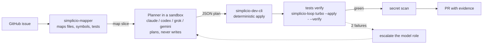

## Kurulum

Python 3.11+, `git` ve GitHub issue'ları için kimliği doğrulanmış bir `gh` gerekir.

```bash
pip install simplicio-loop
simplicio-loop install            # skills + hooks in this project (--global: user-wide, --host <name>: another host)
simplicio-loop doctor             # check the installed stack
```

## Kullanım

**Claude Code veya VS Code'da:**

```text
/simplicio-loop finish all the open issues
```

**7/24 watcher olarak** (`simpletibr/simplicio-*` depolarını izleyip PR açan bir servis):

```bash
simplicio-loop watch247 --once --dry-run          # one simulated tick, changes nothing
simplicio-loop watch247 login-check               # are the exec CLIs logged in?
# from a repo checkout, as root, after creating the non-root user simplicio-loop:
sudo cp packaging/systemd/simplicio-loop-247.service /etc/systemd/system/
sudo cp packaging/systemd/simplicio-loop-247.env.example /etc/simplicio-loop-247.env   # edit it, then chmod 600
sudo systemctl enable --now simplicio-loop-247
```

Ayrıntılar: [docs/WATCHER_247.md](../docs/WATCHER_247.md).

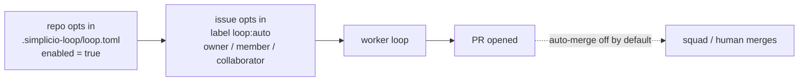

## Nasıl çalışır

<p align="center">
  
</p>

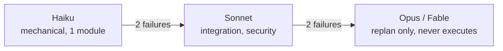

<p align="center">
  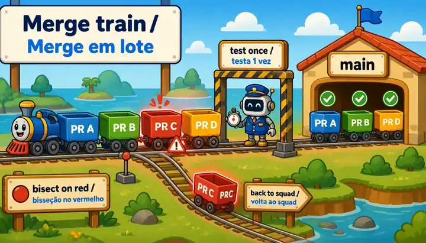
</p>

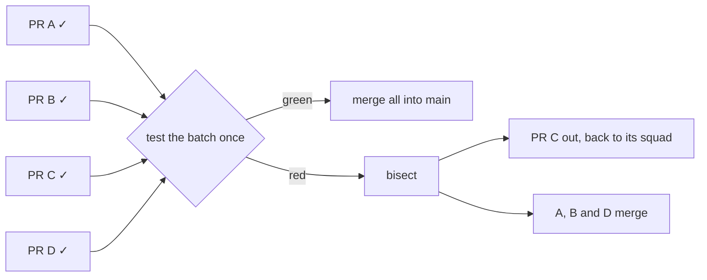

<p align="center">
  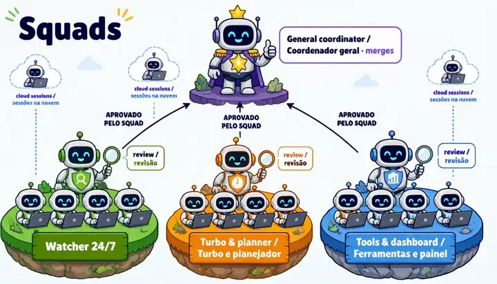
</p>

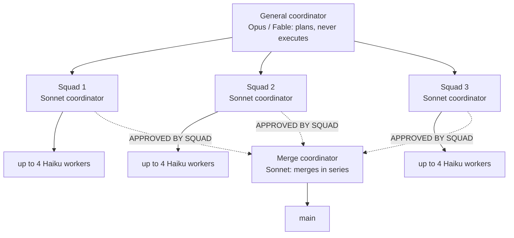

<p align="center">
  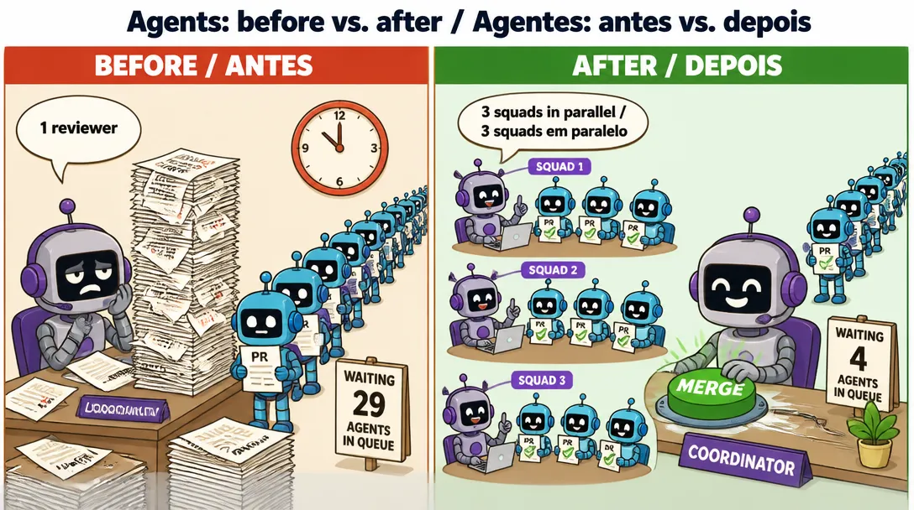
</p>

## 50 genişletme noktası

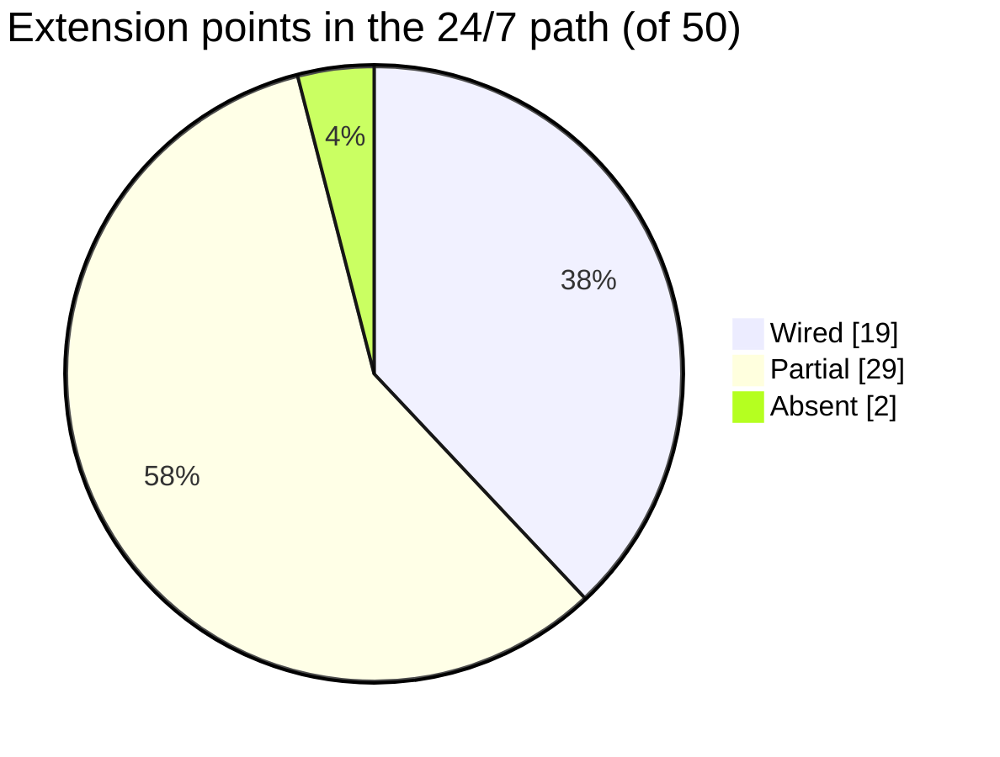

[docs/EXTENSION_POINTS_SERVICE.md](../docs/EXTENSION_POINTS_SERVICE.md) · [#1509](https://github.com/simpletibr/simplicio-loop/issues/1509)

## Çalışma zamanları

- **34 `wired`** adaptörün `adapters/` içinde kodu ve bir ana makine testi var: kataloğun her kurulum ana makinesi; Claude Code, Codex, Grok, Cursor, GitHub Copilot, OpenCode, MiMo Code, Amp, OpenClaude, Antigravity, Pi, oh-my-pi, Hermes Agent (Simplicio Agent), Devin, Goose, Auggie, Autohand Code, Charm, Cline, Codebuff, Command Code, Continue, Droid, Kilocode, Kimi, Kiro, Mistral Vibe, Qwen Code, Rovo Dev, Gemini CLI, Visual Studio Code, OrcaDev / Orca ADE, Aider ve OpenClaw dahil.
- **0 `listed`** ana makine: katalogdaki her ana makinenin adaptör kodu var. DeepSeek bir model sağlayıcısıdır, ana makine değil.
- Yukarıdaki operatörler sıradan komutlardır; bu yüzden `wired` olsun ya da olmasın her harness'ten çalışırlar. Host başına durum: [adapters/MATRIX.md](../adapters/MATRIX.md) ve [simplicio_loop/_catalog/harnesses.json](../simplicio_loop/_catalog/harnesses.json).

## Daha fazlası

- [INSTALL.md](../INSTALL.md) · [docs/CLI_COMMANDS.md](../docs/CLI_COMMANDS.md) · [docs/WATCHER_247.md](../docs/WATCHER_247.md)
- [docs/MODEL_ROLES.md](../docs/MODEL_ROLES.md) · [docs/DASHBOARD.md](../docs/DASHBOARD.md) · [CHANGELOG.md](../CHANGELOG.md)
- **Geri kalan her şey: [docs/GUIDE.md](../docs/GUIDE.md)** (skills, runtimes, döngü, token tasarrufu, güvenlik, testler; İngilizce)
